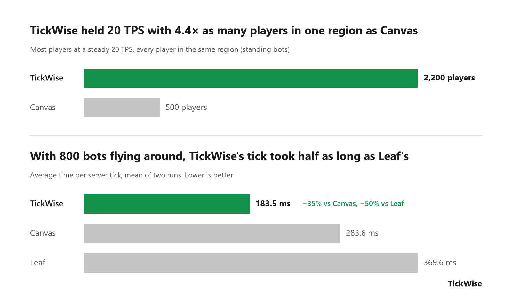
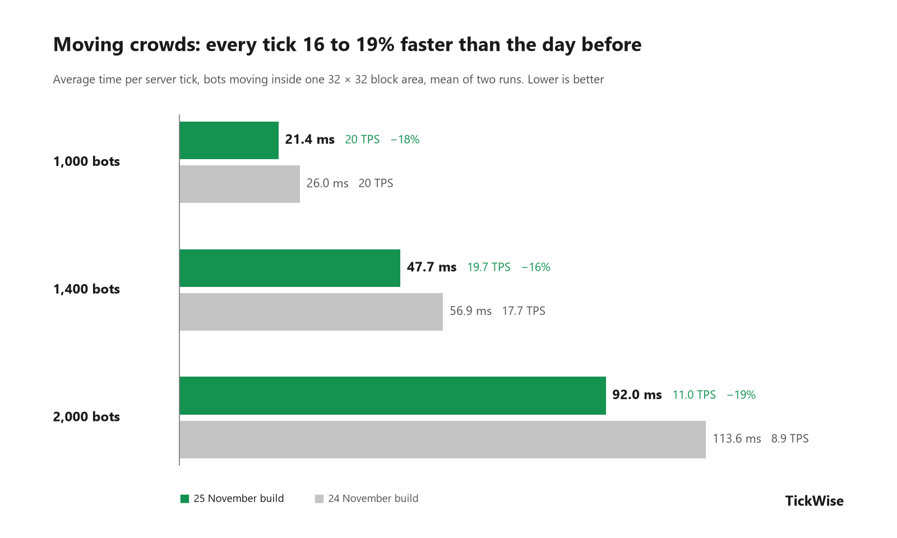

# TickWise-Benchs
Our personal Benchmarks from our Server-Software

## 24 November 2026

Minecraft 1.21.11 server software for big player counts. Gameplay stays vanilla, and the server holds 20 TPS with more players.

- **One region, standing players:** TickWise held 20 TPS with 2,200 players, at a 30.1 ms average tick. Canvas held 20 TPS with 500.
- **800 moving bots, mean of two runs:** TickWise averaged 183.5 ms a tick, Canvas 283.6 ms and Leaf 369.6 ms.

## 25 November 2026

- **Bots moving inside one 32 × 32 block area, Locator Bar off, mean of two runs:** with 1,400 bots TickWise now runs at 19.7 TPS and 47.7 ms a tick (the day before: 17.7 TPS, 56.9 ms). With 2,000 bots it runs at 11.0 TPS and 92.0 ms (the day before: 8.9 TPS, 113.6 ms).
- Gameplay stays vanilla: each change was compared with the original code on a live server and gave the same results.
